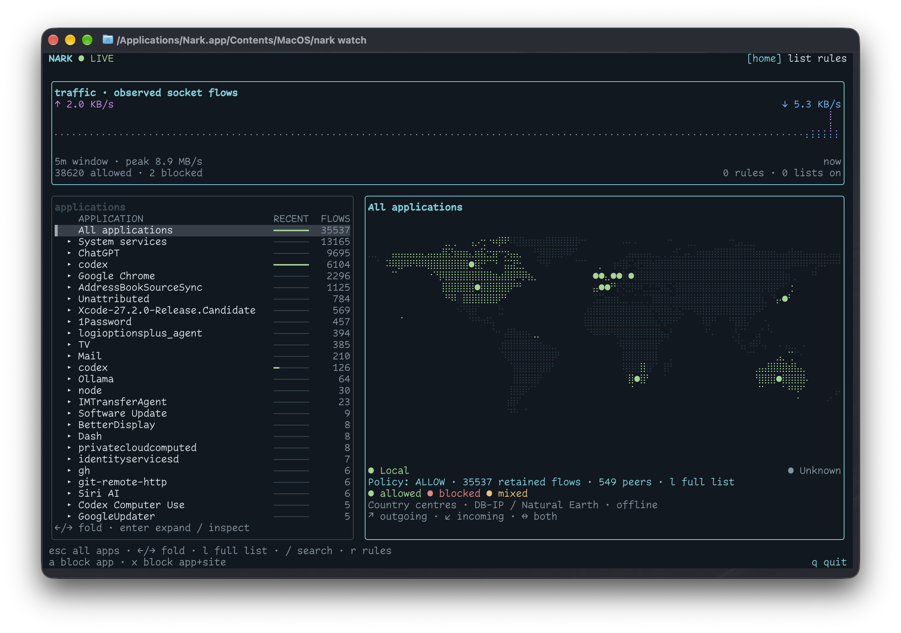

<p align="center">
  
</p>

<h1 align="center">Nark</h1>

A macOS firewall and terminal network monitor. See where apps connect, block unwanted traffic, and record activity.



- Explore connections by app, service or destination.
- Block apps and domains, or use community and custom blocklists.
- Record an app's connections and export Markdown and JSON reports.

## Build

Requires macOS 15+, Xcode 27.2+ and [mise](https://mise.jdx.dev). Select that Xcode version before building, or set `DEVELOPER_DIR` in an ignored `mise.local.toml`.

Copy `Configuration/Signing.example.xcconfig` to `Configuration/Signing.local.xcconfig` and set your Apple Developer team. Open `Nark.xcodeproj` to configure the app and extension's provisioning profiles.

```sh
mise install
mise run build
```

## Run

Copy `DerivedData/Build/Products/Release/Nark.app` to `/Applications`, then:

```sh
/Applications/Nark.app/Contents/MacOS/nark activate
/Applications/Nark.app/Contents/MacOS/nark watch
```

Approve the extension and network filter when macOS prompts you.

Use the arrow keys and Enter to explore, `/` to search, `r` for rules, and `q` to quit. The filter keeps running after you quit the monitor.

For a report, run `nark record APP --output DIR` and press Ctrl-C when finished. Use `nark --help` for all commands.

Blocking applies to new outgoing connections. Incoming connections are observed and allowed. Some encrypted connections appear only as IP addresses.

## Development

```sh
mise run test
mise run format
```

The app logic lives in a Swift package; the Xcode project handles the app and system extension. For Lexicon development, add its checkout as a [local package in your Xcode workspace](https://developer.apple.com/documentation/xcode/editing-a-package-dependency-as-a-local-package). Keep the GitHub dependency in `Package.swift`.

Map locations are approximate. [Geography data and attribution](Sources/Geography/Resources/Attribution.txt).

Maintainers: [release setup and workflow](.github/RELEASING.md).
